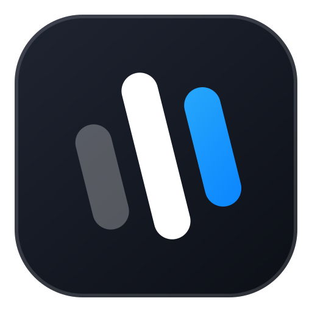
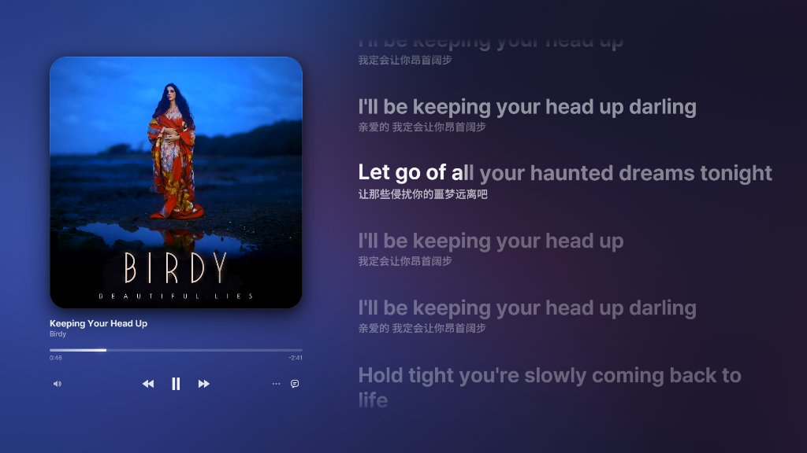
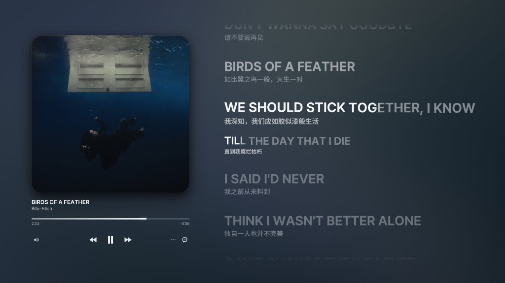

<div align="center">
  
  <h1>OverLyrics</h1>
  <p>基于 <strong>Rust</strong>、<strong>GPUI</strong> 与 <strong>Direct3D 11</strong> 构建的原生 Windows 桌面歌词与音乐伴侣</p>
  <p><em>本项目是一款 Vibe Coding 产物</em></p>
  <p>
    <strong>简体中文</strong> | <a href="README_EN.md">English</a> | <a href="https://overlyrics.steedsha.cn">官方网站</a>
  </p>
  <p>
    
    
    
    
  </p>
</div>

---

## 界面预览

<p align="center">
  
  
</p>

## 核心特性

- **液体玻璃视觉与三种主题**：DirectWrite 文本排版配合 Direct3D 11 实时着色器，提供「液体玻璃 / 浅色 / 深色」三种主题配色与可自定义圆角、强调色。
- **沉浸动态背景与鼓点律动**：基于 OKLCH / Oklab 色彩空间提取专辑封面色调流，并支持 WASAPI 音频捕获，可按需开启边缘光晕闪光与色团律动响应。
- **多词源聚合与本地导入**：支持 **AMLL 歌词库（TTML）**、**酷狗音乐**、**网易云音乐**、**QQ 音乐**、**LRCLIB**，支持版本手动切换与本地 `.lrc` / `.ttml` / `.qrc` / `.yrc` / `.txt` 拖拽导入。
- **独立桌面歌词（横排 / 竖排）**：无边框置顶透明桌面歌词，支持自定义拖边缩放、自动吸附停靠控制栏、长句滚动/自适应缩放、锁定穿透（`Ctrl+L`）、二级颜色菜单与自定义 HSV 调色板。
- **四种窗口形态**：支持 **迷你 / 封面 / 歌词 / 窗口**（含全屏展示）四种模式及 Windows SMTC 多媒体会话切换，满足桌面常驻与全屏沉浸等不同场景。
- **逐字动效与双语翻译**：支持逐字扫光、长音微光与上浮强调、和声副歌行，内置免费翻译与可配置 AI 翻译。
- **单文件绿色运行与自动更新**：Release 产物静态链接运行库并内嵌字体与图标资源，单个 `overlyrics.exe` 双击即用，支持内置检查与一键自更新。

## 快速开始

### 直接下载使用

前往 **[官方网站](https://overlyrics.steedsha.cn)** 或 **[GitHub Releases](https://github.com/steedsha/OverLyrics/releases)** 下载最新单文件 **`overlyrics.exe`**，双击即可运行（无需安装额外运行库）。

### 从源码构建

**环境要求**：Windows 10/11、Rust `>= 1.90`（`x86_64-pc-windows-msvc`）、Visual Studio Build Tools 2022（C++ 桌面开发工作负载 + Windows SDK）。

```powershell
cd native
cargo test --workspace --lib
cargo build --release -p oly-gpui-app --bin overlyrics
```

编译产物位于 `native/target/release/overlyrics.exe`。

## 快捷键

| 按键 | 功能 |
| :--- | :--- |
| `Space` | 播放 / 暂停 |
| `F11` | 进入 / 退出全屏 |
| `Esc` | 逐级关闭当前下拉列表 / 设置 / 子面板 / 浮层，无浮层时退出全屏 |
| `Ctrl + L` | 锁定 / 解锁桌面歌词鼠标穿透 |
| `Left` / `Right` | 快退 / 快进 5 秒（回放模式） |

## 常见问题

<details>
<summary>播放进度与歌词不同步</summary>

不同音源或歌词版本（例如专辑版、单曲版、前奏长短差异）的原始时间轴本身可能存在偏差，受限于歌词源数据，无法做到完全自动对齐。可通过以下方式手动调整：
- 点击底部 **更多 → 歌词同步** 手动微调当前歌曲偏移；
- 在 **更多 → 歌词版本** 中切换其他词源版本；
- 如某一播放器整体存在固定延迟，可在 **设置 → 全局** 中调整对应播放器的同步偏移。

</details>

<details>
<summary>无法识别网易云音乐</summary>

网易云音乐 PC 客户端默认未完整接入 Windows 系统媒体传输控制（SMTC），需安装 [BetterNCM (chromatic)](https://github.com/std-microblock/chromatic) 并安装 **[InfLink-rs](https://github.com/apoint123/inflink-rs)** 插件后，重启网易云音乐即可正常识别与控制。

</details>

<details>
<summary>无法识别 foobar2000</summary>

foobar2000 默认未接入 Windows 系统媒体传输控制（SMTC），需安装 **[foo_mediacontrol](https://github.com/dumbie/foo_mediacontrol)** 插件并重启 foobar2000，即可正常识别播放状态、曲目信息与歌词同步。

</details>

## 致谢与第三方声明

> [!TIP]
> 本项目的逐字歌词数据库与部分时间轴算法得益于开源社区的支持，欢迎大家关注并共同建设这些优秀项目：

- **[AMLL TTML Database](https://github.com/amll-dev/amll-ttml-db)** — 提供高质量社区维护的逐字 TTML 歌词与创作者元数据（本项目会在每首歌词末尾展示创作者信息）。
- **[Apple Music-like Lyrics (AMLL)](https://github.com/amll-dev/applemusic-like-lyrics)** — 逐字动画曲线、时间轴优化与视觉设计参考（AGPL-3.0）。
- **[Lyricify.Lyrics.Helper](https://github.com/jayfunc/Lyricify-Lyrics-Helper)** — 歌词匹配评分与 QRC / KRC 解密算法参考（Apache-2.0）。
- **[OpenCC](https://github.com/BYVoid/OpenCC)** / **[opencc-js](https://github.com/nk2028/opencc-js)** — 简繁字符归一化映射（Apache-2.0 / MIT）。
- **[Pretendard](https://github.com/orioncactus/pretendard)** — 内嵌无衬线字体（SIL OFL 1.1）。
- **[GPUI](https://github.com/zed-industries/zed)** — 底层 UI 框架（Apache-2.0，见 `native/vendor/`）。

完整第三方许可说明见 [THIRD_PARTY_NOTICES.md](THIRD_PARTY_NOTICES.md)。

## 参与贡献

欢迎提交 Issue 与 Pull Request，也十分欢迎社区开发者基于本项目实现 **macOS** 等其他平台版本！

## 开源协议

本项目基于 **[AGPL-3.0](LICENSE)** 协议开源。
