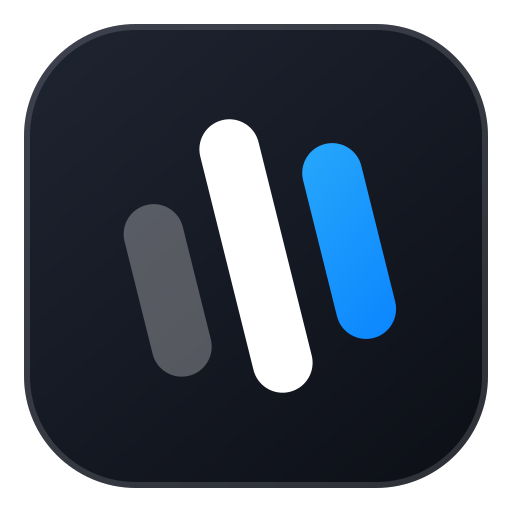
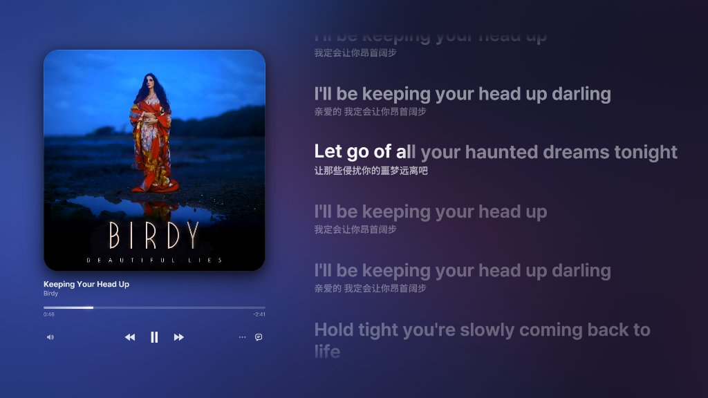
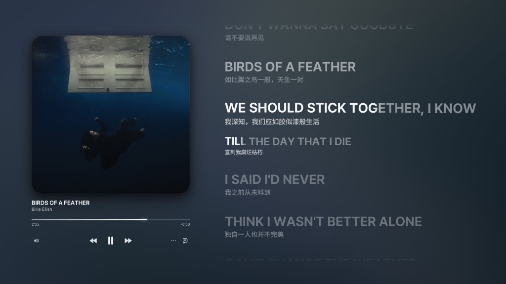

<div align="center">
  
  <h1>OverLyrics</h1>
  <p>A native Windows desktop lyrics &amp; music companion built with <strong>Rust</strong>, <strong>GPUI</strong>, and <strong>Direct3D 11</strong></p>
  <p><em>Built as a Vibe Coding project</em></p>
  <p>
    <a href="README.md">简体中文</a> | <strong>English</strong> | <a href="https://overlyrics.steedsha.cn">Official Website</a>
  </p>
  <p>
    
    
    
    
  </p>
</div>

---

## Preview

<p align="center">
  
  
</p>

## Features

- **Liquid Glass UI & Three Themes**: DirectWrite text shaping paired with Direct3D 11 shaders, offering `Liquid Glass`, `Light`, and `Dark` themes with customizable corner radii and accent colors.
- **Immersion Backdrop & Beat Response**: OKLCH/Oklab palette extraction from album artwork with optional WASAPI audio capture for subtle edge beat-flash and elastic blob motion.
- **Multi-Source Lyrics & Local Import**: Supports **AMLL TTML DB**, **Kugou**, **NetEase Cloud Music**, **QQ Music**, and **LRCLIB**, plus manual version switching and local `.lrc` / `.ttml` / `.qrc` / `.yrc` / `.txt` drag-and-drop import.
- **Standalone Desktop Lyrics (Horizontal & Vertical)**: Borderless always-on-top transparent overlay with resizable edges, elastic hover controls, long-line scrolling / auto-fit, click-through lock (`Ctrl+L`), and a secondary color popover with a custom HSV palette.
- **Four Window Modes**: Switch between `Mini`, `Album`, `Lyrics`, and `Window` (including fullscreen) with Windows SMTC media session switching.
- **Word-by-Word Motion & Translation**: Per-syllable sweep, held-note glow & lift emphasis, harmony/background lines, and built-in free or configurable AI translation.
- **Single-File Binary & Auto-Update**: Statically linked CRT with embedded icon and font fallback — download `overlyrics.exe` and run directly, with built-in update checking and one-click self-update.

## Quick Start

### Download Release

Grab the standalone **`overlyrics.exe`** from the **[Official Website](https://overlyrics.steedsha.cn)** or **[GitHub Releases](https://github.com/steedsha/OverLyrics/releases)** and launch it directly.

### Build from Source

**Prerequisites**: Windows 10/11, Rust `>= 1.90` (`x86_64-pc-windows-msvc`), and Visual Studio Build Tools 2022 (Desktop development with C++ + Windows SDK).

```powershell
cd native
cargo test --workspace --lib
cargo build --release -p oly-gpui-app --bin overlyrics
```

The standalone binary is produced at `native/target/release/overlyrics.exe`.

## Keyboard Shortcuts

| Key | Action |
| :--- | :--- |
| `Space` | Play / Pause |
| `F11` | Toggle fullscreen |
| `Esc` | Step-by-step close active dropdown / settings / sub-panel / popover, or exit fullscreen |
| `Ctrl + L` | Lock / unlock Desktop Lyrics click-through |
| `Left` / `Right` | Seek `-5s` / `+5s` (replay mode) |

## FAQ

<details>
<summary>Lyrics are out of sync with playback</summary>

Due to differences across audio releases and lyric sources (such as intro lengths or album vs. single edits), some tracks may naturally have timing offsets that cannot be eliminated automatically. You can adjust them manually:
- Open **More → Lyrics Sync** (`更多 → 歌词同步`) to nudge the offset for the current track;
- Switch to another candidate in **More → Lyrics Version** (`更多 → 歌词版本`);
- Adjust the global player offset under **Settings → Global** (`设置 → 全局`) if a specific player has a consistent delay.

</details>

<details>
<summary>NetEase Cloud Music is not detected</summary>

The NetEase Cloud Music desktop client does not expose full Windows SMTC playback info by default. Install [BetterNCM](https://std.microblock.cc/betterncm) and its **InfLink-rs** plugin, then restart NetEase Cloud Music.

</details>

<details>
<summary>foobar2000 is not detected</summary>

foobar2000 does not expose Windows System Media Transport Controls (SMTC) by default. Install the **[foo_mediacontrol](https://github.com/ghDaYuYu/foo_mediacontrol)** component and restart foobar2000 to enable playback detection and lyrics sync.

</details>

## Acknowledgements

> [!TIP]
> OverLyrics relies on community-maintained word-by-word lyrics and open-source algorithms. Please consider supporting and contributing to these upstream projects:

- **[AMLL TTML Database](https://github.com/amll-dev/amll-ttml-db)** — Community-contributed TTML word-by-word lyrics & metadata (OverLyrics displays lyricist/author credits at the end of each song).
- **[Apple Music-like Lyrics (AMLL)](https://github.com/amll-dev/applemusic-like-lyrics)** — Word-by-word animation curves, timing optimization, and visual reference (`AGPL-3.0`).
- **[Lyricify.Lyrics.Helper](https://github.com/jayfunc/Lyricify-Lyrics-Helper)** — Match scoring and QRC/KRC decryption ports (`Apache-2.0`).
- **[OpenCC](https://github.com/BYVoid/OpenCC)** / **[opencc-js](https://github.com/nk2028/opencc-js)** — Traditional-to-Simplified Chinese normalization (`Apache-2.0` / `MIT`).
- **[Pretendard](https://github.com/orioncactus/pretendard)** — Embedded sans-serif font (`SIL OFL 1.1`).
- **[GPUI](https://github.com/zed-industries/zed)** — Core UI framework (`Apache-2.0`, vendored under `native/vendor/`).

See [THIRD_PARTY_NOTICES.md](THIRD_PARTY_NOTICES.md) for full license details.

## Contributing

Issues and Pull Requests are always welcome! Community contributions for **macOS and other platform ports** are especially welcome.

## License

Licensed under **[AGPL-3.0](LICENSE)**.
